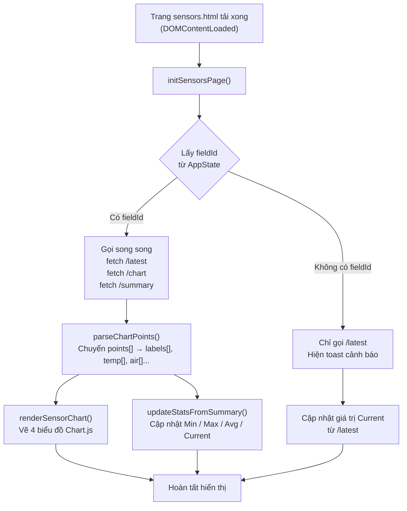
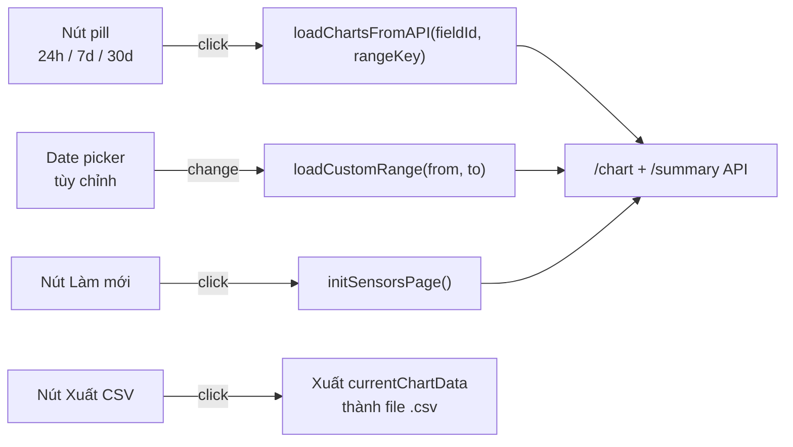

# Tích hợp API Backend cho trang Cảm biến (`sensors.js`)

> **Ngày thực hiện:** 07/11/2026  
> **File thay đổi:** `FE/js/sensors.js`, `FE/js/common.js`  
> **API nguồn:** `backend/telemetry-service` → `TelemetryController.java`

---

## 1. Tổng quan

Trước đây `sensors.js` sử dụng **dữ liệu mẫu tĩnh** (`DATA_SETS`) được hard-code trực tiếp trong file.  
Sau khi tích hợp, trang **Cảm biến** sẽ gọi API thực của backend `telemetry-service` để hiển thị dữ liệu động từ MongoDB.

```
Trước: sensors.js → DATA_SETS (hard-code)
Sau:   sensors.js → fetch() → API Gateway → telemetry-service → MongoDB
```

---

## 2. API được sử dụng

Base URL: `http://localhost:8080/api/telemetry`

| Endpoint | Method | Mục đích | Tham số |
|---|---|---|---|
| `/latest` | GET | Lấy giá trị cảm biến mới nhất (tất cả field) | — |
| `/fields/{fieldId}/chart` | GET | Lấy data points cho biểu đồ | `from`, `to` (ISO 8601), `limit` (mặc định 500) |
| `/fields/{fieldId}/summary` | GET | Lấy thống kê Min / Max / Avg | `from`, `to` (ISO 8601) |

### Response mẫu — `/latest`

```json
{
  "id": "664f1a2b3c4d5e6f7a8b9c0d",
  "fieldId": "664f1a2b3c4d5e6f7a8b9c01",
  "raw": {
    "air_temperature": 28.4,
    "air_humidity": 72.3,
    "soil_moisture": 42.7,
    "light_intensity": 562.0
  },
  "measuredAt": "2026-11-07T04:10:00Z",
  "receivedAt": "2026-11-07T04:10:01Z"
}
```

### Response mẫu — `/fields/{fieldId}/chart`

```json
{
  "fieldId": "664f1a2b3c4d5e6f7a8b9c01",
  "from": "2026-10-31T00:00:00Z",
  "to":   "2026-11-07T00:00:00Z",
  "points": [
    {
      "timestamp": "2026-11-01T06:00:00Z",
      "values": {
        "air_temperature": 25.1,
        "air_humidity": 78.5,
        "soil_moisture": 44.2,
        "light_intensity": 480.0
      }
    }
  ]
}
```

### Response mẫu — `/fields/{fieldId}/summary`

```json
{
  "fieldId": "664f1a2b3c4d5e6f7a8b9c01",
  "totalReadings": 1024,
  "statistics": {
    "air_temperature": { "average": 27.6, "min": 23.1, "max": 34.2 },
    "air_humidity":    { "average": 70.8, "min": 56.2, "max": 92.1 },
    "soil_moisture":   { "average": 41.5, "min": 38.6, "max": 46.5 },
    "light_intensity": { "average": 503.0,"min": 0.0,  "max": 985.0 }
  }
}
```

---

## 3. Mapping key cảm biến

Backend lưu dữ liệu trong trường `raw` của `SensorReading` với các key sau:

| Tên hiển thị | Key backend (`raw`) | Key frontend |
|---|---|---|
| Nhiệt độ không khí | `air_temperature` | `temp` |
| Độ ẩm không khí | `air_humidity` | `air` |
| Độ ẩm đất | `soil_moisture` | `soil` |
| Cường độ ánh sáng | `light_intensity` | `light` |

---

## 4. Luồng hoạt động



### Các hành động người dùng



---

## 5. Các hàm chính trong `sensors.js`

| Hàm | Mô tả |
|---|---|
| `initSensorsPage()` | Entry point — lấy fieldId từ state, gọi song song `/latest`, `/chart`, `/summary` |
| `fetchSensorData(fieldId, rangeKey)` | Gọi `/chart` và `/summary` theo khoảng thời gian |
| `fetchLatest()` | Gọi `/latest` lấy giá trị hiện tại |
| `parseChartPoints(points, rangeKey)` | Chuyển mảng `ChartPoint[]` → arrays `labels, temp, air, soil, light` |
| `loadChartsFromAPI(fieldId, rangeKey)` | Gọi API → render chart + cập nhật stats |
| `loadCustomRange()` | Xử lý date picker tùy chỉnh → gọi API với `from`/`to` cụ thể |
| `renderSensorChart(canvasId, typeKey, labels, data)` | Vẽ / cập nhật Chart.js (giữ nguyên từ bản cũ) |
| `updateStatsFromSummary(typeKey, stats, currentVal)` | Cập nhật Min/Max/Avg/Current lên DOM |
| `setCardLoading(typeKey, loading)` | Hiện / ẩn overlay "Đang tải..." trên mỗi card |
| `getRangeInstants(rangeKey)` | Tính `from` và `to` (ISO 8601) từ range key `'24h'`, `'7d'`, `'30d'` |
| `formatLabel(isoString, rangeKey)` | Format timestamp → label trục X (`HH:mm` hoặc `dd/MM`) |

---

## 6. Cấu hình `fieldId` trong `common.js`

`fieldId` là **MongoDB ObjectId** của từng nhà kính/vườn, được lưu trong `defaultState.zones`.  
File [`common.js`](../js/common.js) đã được thêm trường `fieldId` vào mỗi zone:

```js
zones: [
  {
    id: 1,
    fieldId: 'REPLACE_WITH_FIELD_OBJECTID_1',  // ← cần điền
    name: 'Nhà kính số 1',
    // ...
  },
  {
    id: 2,
    fieldId: 'REPLACE_WITH_FIELD_OBJECTID_2',  // ← cần điền
    name: 'Nhà kính số 2',
    // ...
  }
]
```

> [!IMPORTANT]
> **Cách lấy `fieldId` thực từ MongoDB:**
> ```js
> // Chạy trong MongoDB Compass hoặc mongosh:
> db.getCollection('sensor_readings').findOne({}, { field_id: 1 })
> // Kết quả: { _id: ..., field_id: ObjectId("664f1a2b3c4d5e6f7a8b9c01") }
> // Dùng chuỗi hex: "664f1a2b3c4d5e6f7a8b9c01"
> ```

> [!NOTE]
> Nếu chưa điền `fieldId`, trang vẫn hoạt động nhưng chỉ hiển thị giá trị hiện tại từ `/latest` (không có biểu đồ theo field). Một toast cảnh báo sẽ xuất hiện.

---

## 7. Xử lý lỗi

| Tình huống | Hành vi |
|---|---|
| Backend không chạy / mạng lỗi | Hiện toast `⚠️ Không thể tải dữ liệu cảm biến từ máy chủ` |
| `fieldId` chưa được cấu hình | Hiện toast cảnh báo, chỉ load `/latest` |
| API trả về lỗi HTTP (4xx/5xx) | Log ra console, hiện toast lỗi |
| Không có dữ liệu để xuất CSV | Hiện toast `Không có dữ liệu để xuất` |

---

## 8. Checklist sau khi triển khai

- [ ] Điền `fieldId` thực cho từng zone trong `common.js`
- [ ] Xác nhận backend `telemetry-service` đang chạy tại `localhost:8080`
- [ ] Kiểm tra CORS trên backend cho phép origin `http://localhost` hoặc `file://`
- [ ] Kiểm tra collection `sensor_readings` có dữ liệu trong MongoDB
- [ ] Test tất cả nút pill thời gian (24h / 7d / 30d)
- [ ] Test date range picker tùy chỉnh
- [ ] Test xuất CSV → đảm bảo file chứa dữ liệu thực

